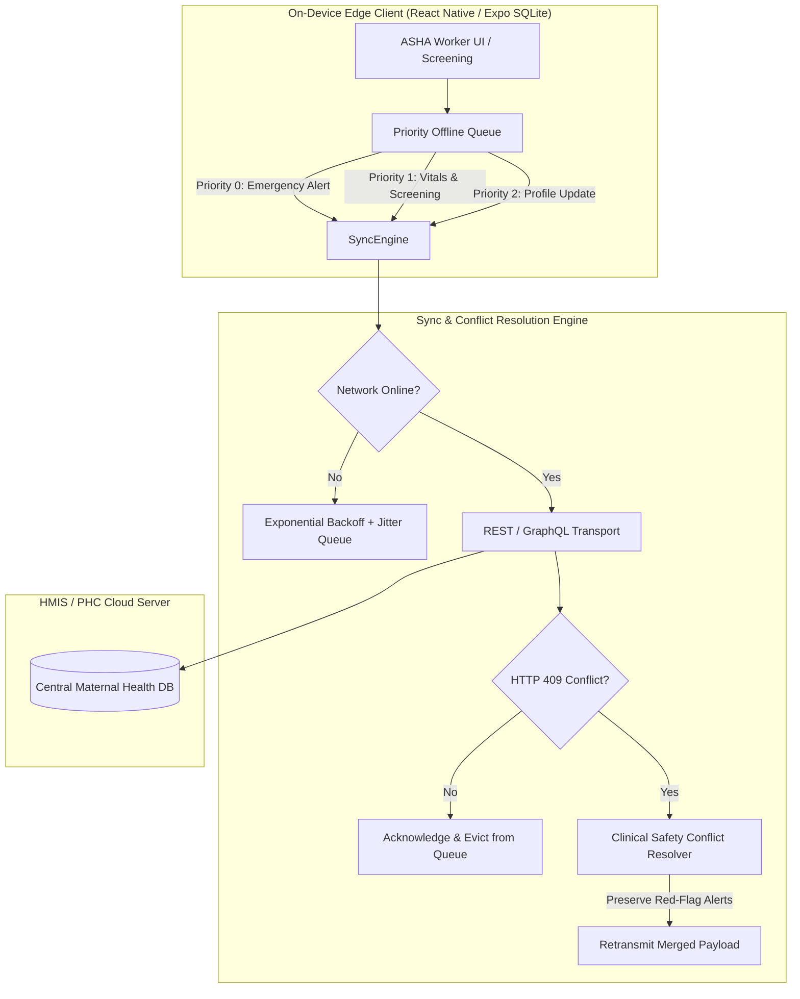

# Offline Synchronization & Clinical Conflict Resolution

IQOO-MAA-AI is engineered for low-resource maternal healthcare in rural Primary Health Centers (PHCs) and sub-centers with intermittent 2G/EDGE or offline field conditions.

---

## 1. Architectural Overview



---

## 2. Priority Tiers

| Priority | Action Types | Processing Guarantee |
| :--- | :--- | :--- |
| **Tier 0 (Critical)** | `DISPATCH_EMERGENCY_ALERT` | Flushed immediately upon connection. Bypasses standard batching queues to ensure emergency referrals (e.g. eclampsia, postpartum hemorrhage) reach the nearest First Referral Unit (FRU) without delay. |
| **Tier 1 (Clinical)** | `RECORD_VITALS`, `RECORD_SCREENING` | High clinical priority. Processed ahead of administrative records. |
| **Tier 2 (Admin)** | `REGISTER_PATIENT`, `UPDATE_CASE_STATUS` | Standard FIFO queue. |

---

## 3. Clinical Conflict Resolution Algorithm

When concurrent records exist (e.g., an ASHA worker records vitals in the field while a medical officer updates records at the PHC), standard database "Last-Write-Wins" can dangerously overwrite a life-threatening symptom (such as severe preeclampsia: $\text{SBP} \ge 160\text{ mmHg}$) with a benign reading taken hours later.

### Maternal Safety Rules:
1. **Clinical Risk Hierarchy**: $\text{CRITICAL} > \text{HIGH} > \text{MODERATE} > \text{LOW}$.
2. If either concurrent record contains a hypertensive crisis, severe anemia ($\text{Hb} < 7.0\text{ g/dL}$), or fetal bradycardia/tachycardia, the **higher risk classification is strictly preserved**.
3. Profiles are merged additively: clinical notes are deduplicated without deletion, and gestational age progression is preserved.

---

## 4. Exponential Backoff with Jitter

Failed transmissions are delayed according to:
$$T_{\text{wait}} = \min\left(T_{\text{max}}, T_{\text{base}} \times 2^{\text{retryCount}} + \text{jitter}\right)$$

Where $T_{\text{base}} = 1000\text{ ms}$, $T_{\text{max}} = 60000\text{ ms}$, and jitter prevents network thundering herd problem when rural towers recover.

---

## 5. Running the Tests

```bash
npm run test:sync
```
